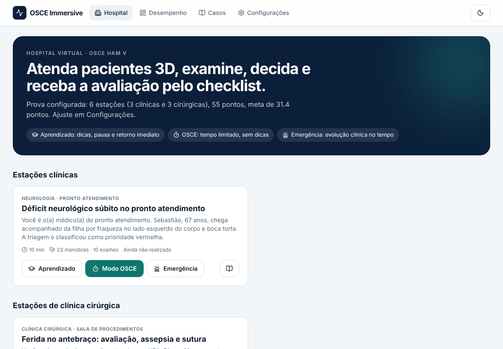
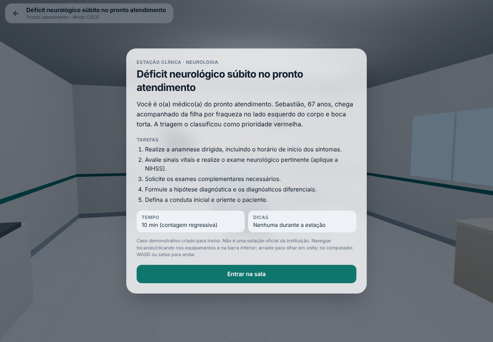
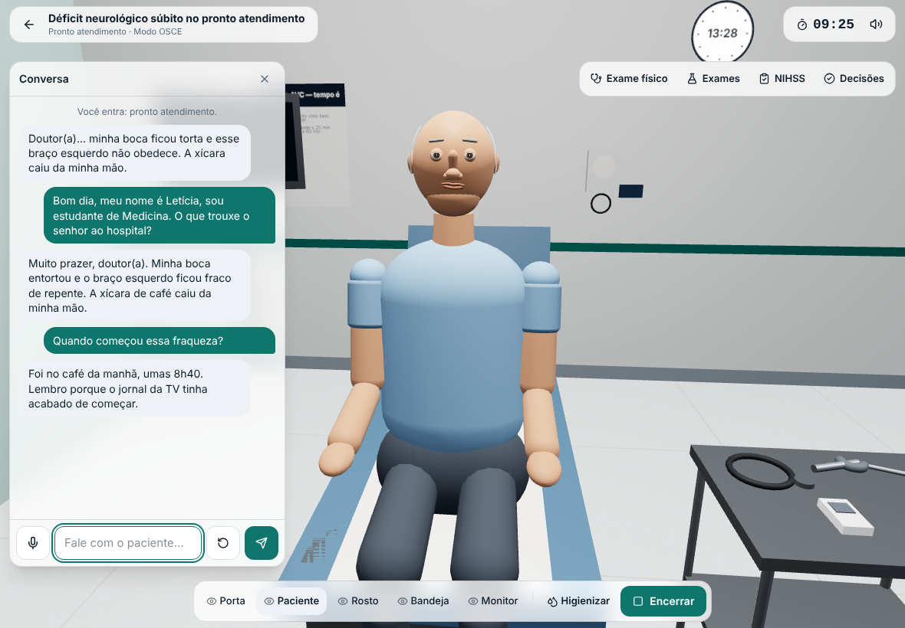
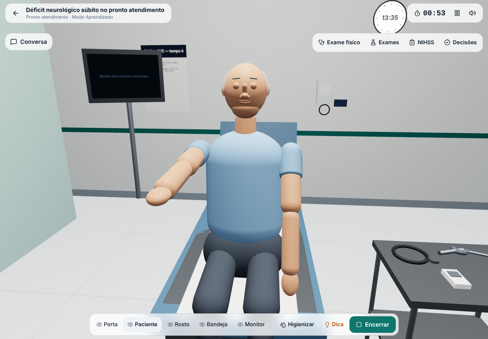
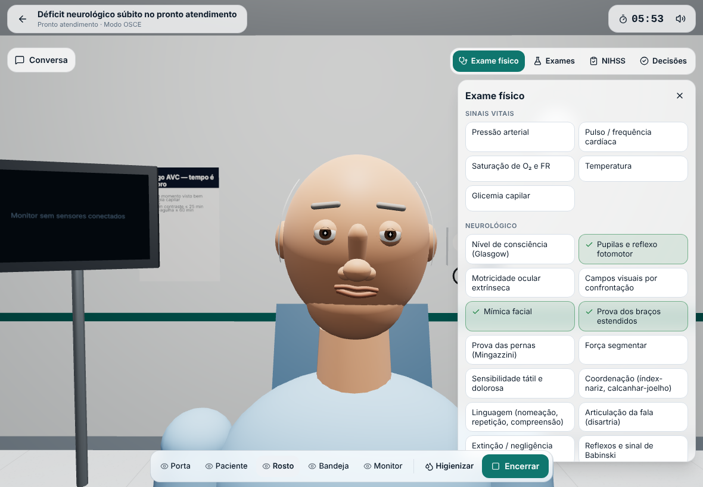

# OSCE Immersive — hospital virtual para treino de OSCE

Simulador de estações OSCE em primeira pessoa. Você entra em uma sala clínica 3D, conversa com um paciente virtual por voz ou texto, examina com escolha de técnica, pede exames, registra hipóteses e conduta e recebe uma avaliação por checklist com relatório e painel de desempenho.

Funciona no navegador do computador e do iPad, sem headset. Os dados ficam no próprio navegador.

> Ferramenta de estudo. As notas são estimativas do simulador a partir de evidências registradas e **não equivalem à avaliação de professores**. Os casos incluídos são **demonstrativos** e não são estações oficiais da Afya.

## Capturas

| | |
|---|---|
|  |  |
|  |  |
|  | |

As capturas foram feitas em um servidor sem GPU (renderização por software); em um iPad ou computador comum a cena roda com fluidez.

## Como rodar

```bash
npm install
npm run dev          # http://localhost:3000
# produção
npm run build && npm start
```

Para usar no iPad: rode o servidor no computador e abra `http://<ip-do-computador>:3000` no Safari do iPad (mesma rede). O microfone do Safari exige HTTPS fora de `localhost`; para isso, publique em um serviço com HTTPS (ex.: Vercel) ou use um túnel HTTPS. Em "Compartilhar → Adicionar à Tela de Início" o app abre em tela cheia.

### IA conversacional (opcional)

Sem configuração, o paciente responde pela **ficha estruturada do caso** (modo determinístico, funciona offline). Para respostas mais naturais:

```bash
export ANTHROPIC_API_KEY=...   # no servidor
# opcional: OSCE_MODELO_IA (padrão claude-opus-5-5)
```

Depois ative em **Configurações → IA conversacional**. A IA recebe somente a ficha do caso, deve citar quais fatos revelou e não pode inventar dados. O fallback do lado do servidor (`fallbacks: "default"`) refaz a chamada em outro modelo se houver recusa. Se a IA falhar, a resposta vem da ficha.

## Desempenho no iPad

- **Qualidade gráfica** (Configurações): Alta, Equilibrada (padrão) ou Economia de bateria — reduz a resolução de renderização.
- Com **Reduzir movimento** ativo no sistema (Ajustes → Acessibilidade → Movimento), a cena é renderizada sob demanda (poucos quadros por segundo) e a câmera troca de ponto de vista sem transição.
- A resolução também cai automaticamente se a taxa de quadros despencar.

## Testes

```bash
npm test             # motor: conversa, avaliação, erros críticos, evolução clínica (vitest)
npm run test:e2e     # navegador: estação de AVC completa, emergência, ferida, configurações (Playwright)
                     # perfis "computador" (1366×820) e "ipad" (1180×820 com toque, no Chromium)
npm run lint
```

## O que existe nesta versão (Fase 1)

| Recurso | Situação |
|---|---|
| Sala 3D navegável (pronto atendimento, sala de procedimentos; consultório, emergência e enfermaria como variações da mesma sala) | Implementado |
| Paciente 3D animado | Implementado (avatar procedural — ver limitações) |
| Estação completa de **AVC isquêmico** (anamnese, sinais vitais, exame neurológico, NIHSS, exames, hipóteses, conduta, orientação) | Implementado |
| Estação cirúrgica de **ferida, assepsia e sutura** | Implementado |
| Conversa por texto e voz, transcrição, repetir pergunta, controle de microfone | Implementado (voz depende do navegador) |
| Exame físico com escolha de **técnica** e avaliação da **sequência** | Implementado |
| Modos Aprendizado, OSCE e Emergência | Implementados |
| Checklist com origem da evidência, erros críticos, revisão manual com justificativa e histórico | Implementado |
| Relatório com sequência ideal, explicações, macetes, plano de revisão, "Refazer" e "Treinar apenas meus erros", exportação PDF | Implementado |
| Painel: radar de competências, evolução, tema, mapa de erros, gestão de tempo, meta 31,4/55, histórico | Implementado (apenas dados reais) |
| Biblioteca de casos: ficha com 14 seções e referências, revisão de conteúdo, edição/importação/exportação em JSON | Implementado |
| Configurações: pontuação total, meta, nº de estações, valor e tempo por estação, política de erro crítico, qualidade gráfica, tema claro/escuro | Implementado |
| Outros casos (crise epiléptica, cefaleia, meningite, delirium, Parkinson, diabetes, otite, vertigem, lombalgia, instrumentais) | **Não incluídos** — planejados (Fase 2). Podem ser importados em JSON. |
| Realidade virtual (WebXR) | **Não implementado** — Fase 3 |

## Transparência: o que é 3D, o que é externo e o que é simplificado

### Realmente tridimensional e interativo
- Sala, mobiliário e equipamentos são geometria 3D renderizada em tempo real (Three.js / React Three Fiber). Pia, esfigmomanômetro, oxímetro, termômetro, glicosímetro, lanterna, martelo, estetoscópio, bandeja e monitor são **clicáveis/tocáveis** e abrem as manobras correspondentes.
- Câmera em primeira pessoa: pontos de vista por toque, arrastar para olhar, WASD/setas no computador.
- O paciente respira na frequência respiratória do caso, mantém contato visual intercalado com desvios do olhar, pisca em intervalos irregulares, tem micro-movimentos de cabeça, expressão de ansiedade e de dor (em manobras dolorosas) e movimenta a mandíbula ao falar.
- Achados representados no corpo 3D: **paresia facial** (comissura labial e sorriso assimétrico), **queda do braço** na prova dos braços estendidos, **queda da perna**, **pupilas** que contraem à luz da lanterna (reflexo direto e consensual), **seguimento ocular** em "H", **ferida** no antebraço (coberta por gaze até a inspeção) e respiração.
- Monitor multiparamétrico com traçado de ECG desenhado em tempo real (irregular na fibrilação atrial) e relógio de parede (hora clínica no modo emergência).

### Simplificações didáticas (declaradas na interface)
- **Avatar procedural**: o paciente é montado com formas geométricas geradas em código. Não é fotorrealista e não usa modelo 3D externo. Não usamos fotos nem imagens fingindo ser personagens 3D.
- **Sincronização labial aproximada**: a boca abre no ritmo das palavras emitidas pela síntese de voz (eventos de palavra), não por fonemas.
- A prova das pernas é mostrada com o paciente **sentado** (adaptação visual da Mingazzini, que é feita deitado).
- Achados sem representação visual fiel (força, reflexos, sensibilidade, ausculta, campos visuais, linguagem, etc.) aparecem como **"achado estruturado"**, identificados na tela, em vez de uma animação enganosa. Os achados com representação 3D recebem o selo **"3D"**.
- O modo emergência usa um **relógio clínico** determinado por regras do caso: o tempo real corre, perguntas e manobras custam minutos, exames de imagem levam o paciente (o relógio avança) e exames laboratoriais ficam prontos após o prazo. Sinais vitais seguem a curva definida no caso e mudam conforme as decisões (ex.: anti-hipertensivo reduz a PA após 10 min). Nada é sorteado.
- O tempo por etapa é estimado pelo intervalo entre as ações registradas.

### Depende de serviços/recursos externos
- **Reconhecimento de voz** e **voz do paciente** usam a Web Speech API do navegador. Chrome e Edge reconhecem fala; no Safari/iPadOS o suporte existe mas varia por versão; o Firefox não reconhece fala. Sem suporte, o botão de microfone fica desativado e a conversa é por texto. A qualidade da voz depende das vozes pt-BR instaladas no aparelho.
- **IA conversacional** é opcional e exige `ANTHROPIC_API_KEY` no servidor.

## Como a avaliação funciona

Cada item do checklist tem um critério verificável e mostra a **origem da evidência**:

| Origem | Exemplo | Pontua automaticamente? |
|---|---|---|
| Ação na tela | manobra com técnica correta, exame pedido, decisão registrada | Sim |
| Fala verificada | regra determinística reconheceu a pergunta/fala do aluno | Sim |
| Interpretação de IA | fato revelado só pela IA opcional | **Não** — aguarda revisão |
| Avaliação humana | empatia, postura | **Não** — aguarda revisão |

- Manobra com técnica inadequada **não conta** como realizada.
- Itens de sequência (ex.: higienizar as mãos antes de tocar o paciente; glicemia antes da decisão) verificam a ordem real.
- Erros críticos são regras do caso (ex.: trombólise sem TC, antiagregante antes da imagem, anestesiar antes de testar a sensibilidade). A política "zerar a estação" é configurável.
- Revisão manual exige justificativa e fica registrada no histórico da tentativa.

### Pontuação da prova
A prova é configurável (padrão HAM V: 6 estações — 3 clínicas e 3 cirúrgicas —, 55 pontos, meta 31,4). Como a distribuição oficial de pontos por estação não é conhecida, o simulador **não presume**: sem valor informado, a projeção usa a divisão igual e é marcada como suposição. Informe os valores reais em Configurações.

### Limites da verificação
- Os testes de navegador rodam no **Chromium** com tela do tamanho de um iPad e toque. O **Safari/WebKit real do iPad não estava disponível** no ambiente de desenvolvimento: teste no aparelho antes de uma sessão importante (principalmente o microfone).
- O ambiente de testes não tem GPU; os testes usam o modo de movimento reduzido para manter a página responsiva.

## Formato dos casos (importação)

Baixe o modelo em **Casos → Baixar modelo** (é o caso de AVC completo). O schema está em `src/lib/caso/schema.ts`; a importação valida o arquivo e confere se todos os ids citados no checklist e nas regras existem. Principais blocos:

- `paciente` (falas fixas, respostas para o que não está na ficha, limitações) e `fatos` (o que o paciente sabe; cada fato só é revelado por perguntas que contenham seus `gatilhos`);
- `manobras` (sistema, técnicas certas/erradas, achado, `visual` opcional) e `exames` (resultado, tempo no modo emergência);
- `decisoes` (hipótese, diferenciais, janela, conduta, orientações), `checklist` e `errosCriticos`;
- `evolucao` (curva de sinais vitais, efeitos de decisões, eventos por tempo e metas) para o modo emergência;
- `ficha` (14 seções didáticas, sequência ideal, macetes e referências) e `revisao` (status de revisão do conteúdo).

## Arquitetura

- **Next.js 16 (App Router) + TypeScript + Tailwind CSS 4**
- **React Three Fiber + Drei + Three.js** — `src/components/three`
- **Recharts** — `src/components/graficos`
- **Motor sem dependência de interface** — `src/lib/engine` (conversa, sessão/registro de eventos, avaliação, evolução clínica, relatório), testado com Vitest
- **Persistência local** — `localStorage` (`src/lib/store`), com exportação de backup
- **IA opcional** — `src/app/api/paciente/route.ts` (SDK oficial da Anthropic, saída estruturada validada)

A versão anterior (HTML estático) continua disponível em `/v1/index.html`.

## Referências clínicas dos casos

Listadas na ficha de cada caso e no relatório (AHA/ASA 2019, Linha de Cuidado do AVC do Ministério da Saúde, diretriz brasileira de trombólise, NIHSS; Manual de Normas e Procedimentos para Vacinação do MS, ANVISA, NR-32, AFP). O conteúdo está marcado como **rascunho** até revisão por docente; o status pode ser atualizado na biblioteca de casos.

## Roteiro

- **Fase 2**: mais personagens e casos (lista acima), sala de emergência própria, mais exames, importação de PDFs/roteiros, sincronização em nuvem.
- **Fase 3**: modelos 3D licenciados com morph targets faciais (sincronização labial por visemas), animações clínicas específicas (marcha, crise), interação com objetos 3D (pegar o estetoscópio), WebXR para headsets, cenários dinâmicos.
